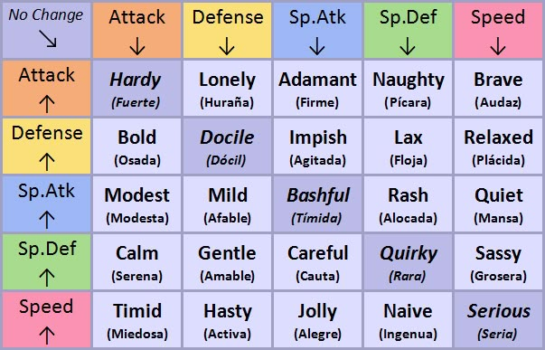

# Manual

El objetivo ...

## 📌 Índice de contenidos

* [1. Caracterización de un pokémon.](#1-caracterización-de-un- )
    * [1.1. Tipos.](#11-tipos)
    * [1.2. Habilidades.](#12-habilidades)
    * [1.3. Estadísitcas.](#13-estadísticas)
        * [1.3.1 IVs, EVs y naturalezas.](#131-ivs-evs-y-naturalezas)
        * [1.3.2 Cálculo de una estadística.](#132-calculo-estadística)
    * [1.4. Movimientos. ](#14-movimientos)
* [2. Pasos a seguir para entrenar a un pokémon.](#2-pasos-para-entrenar-a-un-pokemon)
    * [2.1. Crianza.](#21-crianza)
        * [2.1.1 Grupos huevo.](#211-grupos-huevo)
        * [2.1.2 Herencia.](#herencia)
    *(Sin completar)*

*(Expansible)*


## 1. Caracterización de un pokémon.

Además de por su diseño particular, las distintas especies de Pokémon se diferencian a nivel funcional en torno a **cuatro pilares principales**: sus *tipos*, sus *habilidades*, sus *estadísticas base* y los *movimientos* que son capaces de aprender.

### 1.1. Tipos

El tipo (o combinación de dos tipos) determina las debilidades y resistencias elementales de la criatura frente a ataques enemigos, además de otorgar la bonificación por *STAB* (*Same Type Attack Bonus*).

> Un ataque ejecutado por un pokémon que comparte su mismo tipo recibe un multiplicador del **1.5x** en su potencia base.

### 1.2. Habilidades

Las habilidades son efectos pasivos que influyen en el combate. Cada especie puede poseer hasta dos habilidades ordinarias y una *habilidad oculta* especial de entre 316 totales.

### 1.3. Estadísticas

Las 6 estadísticas base definen el rendimiento del pokémon en batalla:

* **PS**
* **Ataque** 
* **Defensa** 
* **Ataque Especial**
* **Defensa Especial**
* **Velocidad**

#### 1.3.1. IVs, EVs y naturalezas

Para personalizar el rendimiento, se utilizan valores individuales y de esfuerzo:

1. **IVs**: Valores genéticos fijos de `0` a `31` en cada estadística.
2. **EVs**: Puntos asignados mediante entrenamiento. Un pokémon puede acumular hasta `510` EVs totales y un máximo de `252` en una sola estadística.
3. **Naturaleza:** Aumenta un atributo en un $10\%$ y reduce otro en un $10\%$. A continuación se adjunta una tabla con las existentes.



#### 1.3.2. Cálculo de una estadística.

Una vez introducidos los conceptos necesarios, se presentan las fórmulas para calcular el valor numérico de una estadística concreta.

```python
def calcular_ps(base, iv, ev, nivel=100):
    """
    Suponiendo un pokémon a nivel máximo, sin tener en cuenta la naturaleza.
    """
    ps_final = int(((2 * base + iv + int(ev / 4)) * nivel) / 100) + nivel + 10
    return ps_final
```

```python
def calcular_estadistica(base, iv, ev, nivel=100):
    """
    Suponiendo un pokémon a nivel máximo, sin tener en cuenta la naturaleza.
    """
    estadistica_final = int(((2 * base + iv + int(ev / 4)) * nivel) / 100) + 5
    return estadistica_final
```

---

## 2. Pasos a seguir para entrenar a un Pokémon

???

### 2.1. Crianza

La crianza en la guardería permite la herencia genética.

#### 2.1.1. Grupos huevo

Los pokémon solo pueden reproducirse entre sí si comparten al menos un grupo huevo, pudiendo pertenecer a un máximo de dos.

| Grupo Huevo | Ejemplos de Pokémon | Características |
| :--- | :--- | :--- |
| **Monstruo** | Charizard, Tyranitar | Criaturas de aspecto grande o reptiliano. |
| **Campo** | Pikachu, Lucario | Mamíferos terrestres de diverso tamaño. |
| **Desconocido** | Ditto, Legendarios | No pueden criar entre sí (salvo Ditto). |


*(Hay más, está incompleto)*

#### 2.1.2. Herencia

1. Equipar la **Lazo Destino** (*Knot Destiny*) a uno de los padres para heredar 5 IVs aleatorios de entre los 12 de ambos padres.
2. Equipar la **Piedra Eterna** (*Everstone*) para heredar con un $100\%$ de certeza la naturaleza deseada.
3. Eclosionar huevos de forma iterativa hasta conseguir los 5 o 6 IVs perfectos.

*(No es una secuencia ordenada como tal, pero se pide al menos una.)*

Se observa que para lograr el resultado deseado, es necesario partir de unos padres con buena genética.


